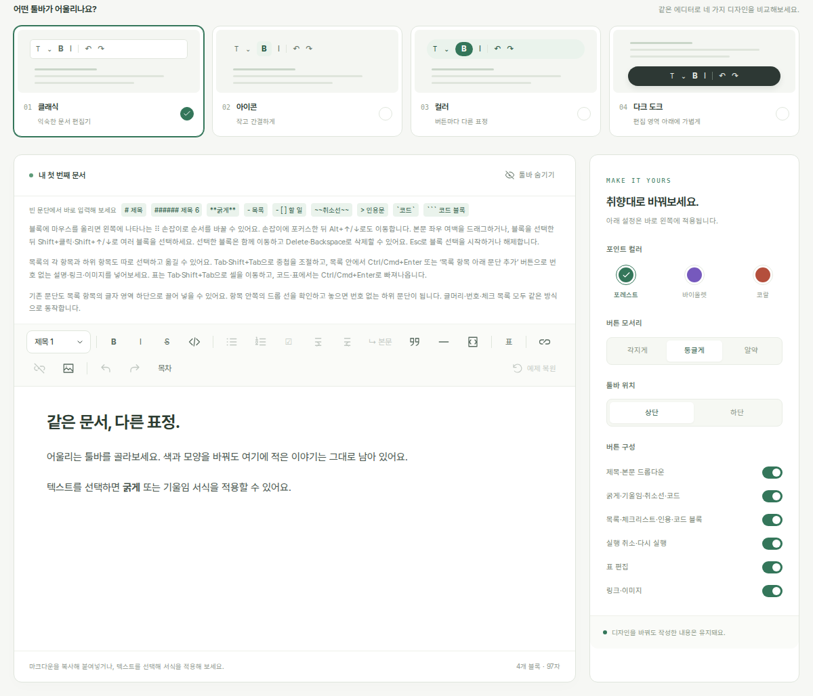

<div align="center">


# vLab Editor

**문서는 그대로, 툴바는 내 취향대로.**

[ProseMirror](https://prosemirror.net/) 기반 React 블록 에디터입니다. Markdown을 가져오고 내보내며, 툴바와 편집 화면을 앱에 맞게 조합할 수 있습니다.

[](https://www.npmjs.com/package/vlab-editor)
[](https://github.com/Victor-Choe/vlab-editor/actions/workflows/ci.yml)
[](https://react.dev/)
[](./LICENSE)

[**Playground 체험하기**](https://victor-choe.github.io/vlab-editor/) · [npm](https://www.npmjs.com/package/vlab-editor) · [문서](#문서) · [English](./README.md)

</div>

[](https://victor-choe.github.io/vlab-editor/)

Playground에서는 같은 에디터를 네 가지 툴바로 구성했습니다. 버튼·색상·배치를 바꿔도 작성 중인 문서는 유지됩니다.

[설치](#설치) · [빠른 시작](#빠른-시작) · [주요 기능](#주요-기능) · [활용 예제](#활용-예제) · [로컬 개발](#로컬-개발)

## 설치

React 19 프로젝트에 패키지를 설치합니다.

```sh
npm install vlab-editor
```

pnpm을 사용한다면:

```sh
pnpm add vlab-editor
```

React 19와 React DOM 19는 peer dependency입니다. ESM 모듈, TypeScript 타입 선언, 선택해서 가져오는 기본 CSS를 제공합니다. Playground는 Tailwind CSS를 사용하지만, 에디터 패키지는 Tailwind CSS를 요구하지 않습니다.

## 빠른 시작

에디터를 만들고 Provider로 공유한 뒤 원하는 툴바 버튼을 조합합니다.

```tsx
"use client"

import {
  BoldButton,
  EditorContent,
  EditorProvider,
  ItalicButton,
  ToolBar,
  UndoButton,
  useEditor,
} from "vlab-editor"
import "vlab-editor/styles.css"

export function Writer() {
  const editor = useEditor({ markdown: "# 안녕하세요, vLab Editor" })

  return (
    <EditorProvider editor={editor}>
      <ToolBar>
        <BoldButton />
        <ItalicButton />
        <UndoButton />
      </ToolBar>
      <EditorContent className="document" />
      <button type="button" onClick={() => console.log(editor.getMarkdown())}>
        Markdown 내보내기
      </button>
    </EditorProvider>
  )
}
```

본문 글꼴·여백·줄 간격은 앱의 CSS로 지정합니다.

```css
.document > .ProseMirror {
  min-height: 240px;
  padding: 24px 36px;
  line-height: 1.7;
}
```

`ToolBar`에 자식 요소를 넣지 않으면 기본 버튼 구성을 제공합니다. 자식 요소를 전달하면 버튼의 순서·문구·아이콘·스타일을 직접 정할 수 있습니다. 기본 문구는 한국어이며, 버튼의 `aria-label`, `title`, `children`으로 바꿉니다. 편집 영역 내부의 접근성 레이블은 [API 안내](./docs/api.md#react-components)를 참고하세요.

> [!NOTE]
> Next.js App Router에서는 위 예제처럼 클라이언트 컴포넌트에서 사용합니다. 서버는 편집기 컨테이너를 렌더링하며 실제 편집 문서는 hydration 후 나타납니다. 인스턴스 하나에는 편집 화면 하나만 동시에 연결할 수 있습니다.

## 주요 기능

| 영역 | 제공하는 기능 |
| --- | --- |
| **문서 편집** | H1–H6, 본문, 중첩 목록, 체크리스트, 인용문, 구분선, 링크, 이미지, 코드 블록, 인라인 서식 |
| **표** | 셀 선택, 행·열 편집 명령, 헤더 행, GFM 정렬 |
| **Markdown** | 가져오기·내보내기, 입력 단축키, Markdown 붙여넣기, 변환 오류 안내 |
| **툴바** | 조합 가능한 React 버튼, 커스텀 명령, 활성·비활성 상태, 앱의 스타일 적용 |
| **블록 조작** | 선택형 드래그 손잡이, 범위 선택, 키보드 순서 변경, 블록 복사·잘라내기 |
| **미디어** | 링크·이미지 편집, 앱의 업로더 연결, 업로드 취소, 삽입 위치 추적 |
| **확장** | ProseMirror 스키마·플러그인·단축키·NodeView·Markdown 규칙 연결 |
| **React 연결** | DOM 없는 인스턴스 생성, 필요한 상태만 구독, 화면 재연결 시 문서·실행 취소 기록 유지 |

ProseMirror의 편집 기능 위에 블록 스키마, Markdown 변환, 에디터 수명 관리와 React 컴포넌트를 연결했습니다. 저장·인증·업로드 서버와 주변 입력 폼은 사용하는 앱이 담당합니다.

## 활용 예제

### 문서 읽기·저장·교체

```ts
import { Editor, parseMarkdown, serializeMarkdown } from "vlab-editor"

const editor = new Editor({ markdown: "**안녕하세요**" })
const markdown = editor.getMarkdown()
const json = editor.state.doc.toJSON()

editor.replaceMarkdown("실행 취소할 수 있는 문서 변경")
editor.setMarkdown("## 새 문서")

const doc = parseMarkdown(markdown)
const normalizedMarkdown = serializeMarkdown(doc)
```

`onChange(state)`에서 `state.doc.toJSON()`을 앱의 저장 함수로 전달할 수 있습니다. `replaceMarkdown()`은 이전 실행 취소 기록을 유지하며 업로드 중에는 교체를 거절합니다. `setMarkdown()`은 파싱에 성공한 뒤 문서를 교체하고 선택·기록을 초기화하며 업로드를 취소합니다.

> [!IMPORTANT]
> Markdown 출력은 정규화되어 원문의 표기와 빈 줄 개수를 그대로 보존하지 않습니다. 지원 형식으로 표현할 수 없는 내용은 `MarkdownConversionError`를 일으킬 수 있으며, 문서 교체에 실패하면 기존 문서를 유지합니다. 저장 형식을 정하기 전에 [Markdown 지원 범위](./docs/markdown.md)를 확인하세요.

<details>
<summary><strong>블록 손잡이와 키보드 순서 변경 추가하기</strong></summary>

```tsx
"use client"

import {
  blockDragAndDrop,
  EditorContent,
  EditorProvider,
  ToolBar,
  useEditor,
} from "vlab-editor"
import "vlab-editor/styles.css"

const extensions = [blockDragAndDrop()]

export function BlockWriter() {
  const editor = useEditor({
    markdown: "# 초안\n\n이 문단을 옮겨보세요.",
    extensions,
  })

  return (
    <EditorProvider editor={editor}>
      <ToolBar />
      <EditorContent className="document" />
    </EditorProvider>
  )
}
```

빠른 시작의 CSS처럼 손잡이가 표시될 왼쪽 여백을 확보합니다. 드래그 또는 손잡이의 Alt+↑/↓로 블록을 옮기고, Shift+클릭으로 여러 블록을 선택할 수 있습니다. 자세한 조작은 [블록 선택·드래그 안내](./docs/extensions.md#block-dragging-and-selection)를 참고하세요.

</details>

<details>
<summary><strong>내 이미지 업로드 API 연결하기</strong></summary>

```tsx
"use client"

import { useEditor } from "vlab-editor"

export function useImageEditor(uploadUrl: string) {
  return useEditor({
    uploadImage: async (file, { signal }) => {
      const body = new FormData()
      body.append("file", file)
      const response = await fetch(uploadUrl, { method: "POST", body, signal })
      if (!response.ok) throw new Error("이미지 업로드에 실패했습니다.")
      const result: { url: string } = await response.json()
      return { src: result.url, alt: file.name }
    },
  })
}
```

업로더를 연결하면 이미지 붙여넣기와 이미지 파일 드롭도 같은 함수를 사용합니다. 요청 중 삽입 위치는 에디터가 추적하고, 인증·파일 제한·오류 표시는 앱이 담당합니다. 자세한 계약은 [업로드 안내](./docs/media.md#upload-integration)에 있습니다.

</details>

<details>
<summary><strong>코드 하이라이트와 커스텀 블록 화면 연결하기</strong></summary>

선택형 `vlab-editor/highlight` 어댑터에 앱의 lowlight 인스턴스를 연결할 수 있습니다. 언어 정의와 하이라이트 테마는 앱이 선택하며 기본 진입점에서는 불러오지 않습니다.

`EditorExtension`으로 ProseMirror 노드·서식·플러그인·단축키·NodeView·Markdown 규칙을 등록합니다. 구성은 에디터 인스턴스를 생성할 때 결정합니다.

완성된 예제는 [코드 하이라이트](./docs/extensions.md#code-highlighting)와 [커스텀 NodeView](./docs/extensions.md#native-plugins-and-nodeviews)를 참고하세요.

</details>

## 문서

개발 문서는 영문으로 제공합니다.

| 안내 | 내용 |
| --- | --- |
| [API](./docs/api.md) | 컴포넌트, 상태 구독, 명령, 콜백, 수명 관리 |
| [Markdown](./docs/markdown.md) | 지원 문법, 정규화, 입력 규칙, 변환 오류 |
| [확장](./docs/extensions.md) | 하이라이트, 커스텀 블록, 플러그인, 블록 드래그 |
| [링크와 이미지](./docs/media.md) | 미디어 명령, 주소 처리, 입력 폼, 업로드 |
| [내부 구조](./docs/architecture.md) | 상태, 브라우저 뷰, React, 변환의 연결 |
| [Playground 소스](https://github.com/Victor-Choe/vlab-editor/tree/main/playground) | 툴바 구성, 문서 검사 패널, 실제 연결 예제 |
| [기여 안내](./CONTRIBUTING.md) | 개발 환경, PR, 검사 명령 |
| [배포 안내](./docs/releasing.md) | 패키지 검사와 npm 배포 |

## 로컬 개발

Node.js 24와 pnpm 11.3.0을 사용합니다.

```sh
git clone https://github.com/Victor-Choe/vlab-editor.git
cd vlab-editor
pnpm install
pnpm dev
```

<http://localhost:3005>에서 확인할 수 있습니다. 라이브러리 소스를 수정하면 자동으로 다시 빌드합니다. 네 가지 툴바 스타일은 playground에서 조합한 예제이므로 소스를 참고해 앱에 맞게 바꿀 수 있습니다.

```sh
pnpm check
```

린트, 라이브러리·테스트 타입 검사, Node.js/jsdom 단위·통합 테스트, playground 프로덕션 빌드를 실행합니다. 개별 명령은 [기여 안내](./CONTRIBUTING.md#checks)에 정리되어 있습니다.

---

vLab의 [Victor Choe](https://github.com/Victor-Choe)가 만들었습니다. · [MIT](./LICENSE) · [ProseMirror](https://prosemirror.net/) 기반
