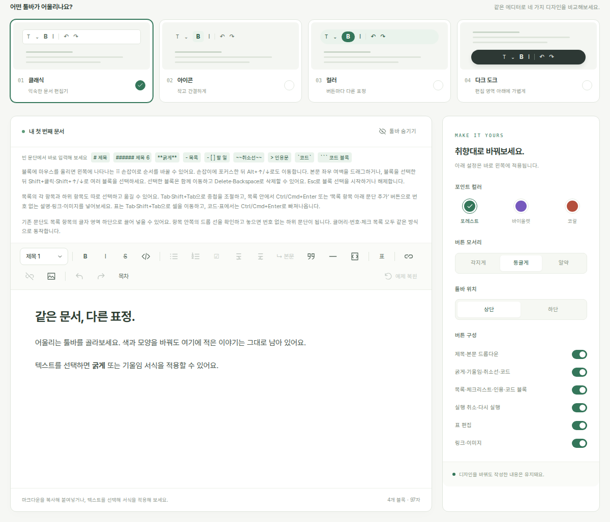

<div align="center">


# vLab Editor

**Your document. Your toolbar.**

A composable React block editor built on [ProseMirror](https://prosemirror.net/), with Markdown import/export and a UI you can make your own.

[](https://www.npmjs.com/package/vlab-editor)
[](https://github.com/Victor-Choe/vlab-editor/actions/workflows/ci.yml)
[](https://react.dev/)
[](./LICENSE)

[**Try the playground**](https://victor-choe.github.io/vlab-editor/) · [npm](https://www.npmjs.com/package/vlab-editor) · [Documentation](#documentation) · [한국어](./README.ko.md)

</div>

[](https://victor-choe.github.io/vlab-editor/)

One editor, four toolbar compositions in the playground. Change buttons, colors, and placement while keeping the same document.

[Install](#installation) · [Quick start](#quick-start) · [Features](#features) · [Recipes](#recipes) · [Development](#local-development)

## Installation

Add the package to a React 19 project:

```sh
npm install vlab-editor
```

Or with pnpm:

```sh
pnpm add vlab-editor
```

React 19 and React DOM 19 are peer dependencies. The package ships ESM modules, TypeScript declarations, and optional editor styles. Tailwind CSS is used by the playground; it is not required by the editor.

## Quick start

Create an editor, share it through a provider, and compose your toolbar:

```tsx
"use client"

import {
  BoldButton,
  EditorContent,
  EditorProvider,
  ItalicButton,
  ToolBar,
  UndoButton,
  useEditor,
} from "vlab-editor"
import "vlab-editor/styles.css"

export function Writer() {
  const editor = useEditor({ markdown: "# Hello, vLab Editor" })

  return (
    <EditorProvider editor={editor}>
      <ToolBar aria-label="Formatting">
        <BoldButton aria-label="Bold" title="Bold">B</BoldButton>
        <ItalicButton aria-label="Italic" title="Italic">I</ItalicButton>
        <UndoButton aria-label="Undo" title="Undo">Undo</UndoButton>
      </ToolBar>
      <EditorContent className="document" />
      <button type="button" onClick={() => console.log(editor.getMarkdown())}>
        Export Markdown
      </button>
    </EditorProvider>
  )
}
```

Give the document your own typography and spacing:

```css
.document > .ProseMirror {
  min-height: 240px;
  padding: 24px 36px;
  line-height: 1.7;
}
```

`ToolBar` without children supplies a default set of buttons. Pass children to choose their order, labels, icons, and styles. Built-in labels currently default to Korean; the example overrides button labels and titles. See the [accessibility-label guide](./docs/api.md#react-components) for the inner editable element.

> [!NOTE]
> For Next.js App Router, use a client component as shown above. Server rendering produces the editor container; the editable document mounts after hydration. One editor instance supports one mounted content view at a time.

## Features

| Area | What you can build with |
| --- | --- |
| **Document editing** | H1–H6, paragraphs, nested lists, task lists, quotes, rules, links, images, code blocks, and inline formatting |
| **Tables** | Cell selection, row/column commands, header rows, and GFM alignment |
| **Markdown** | Import/export, typing shortcuts, Markdown paste, and explicit conversion errors |
| **Toolbars** | Composable React buttons, custom commands, active/disabled state, and application-owned styling |
| **Block interaction** | Optional drag handles, range selection, keyboard reordering, and structural copy/cut |
| **Media** | Link/image editing, application-provided uploads, cancellation, and insertion-position tracking |
| **Extensions** | Native ProseMirror schemas, plugins, keymaps, NodeViews, and Markdown rules |
| **React lifecycle** | DOM-free instance creation, selective state subscriptions, and document/history retention across view remounts |

ProseMirror supplies the editing primitives. vLab Editor connects a block schema, Markdown conversion, editor lifecycle, and React controls. Your application owns persistence, authentication, upload endpoints, and surrounding forms.

## Recipes

### Read, save, and replace content

```ts
import { Editor, parseMarkdown, serializeMarkdown } from "vlab-editor"

const editor = new Editor({ markdown: "**Hello**" })
const markdown = editor.getMarkdown()
const json = editor.state.doc.toJSON()

editor.replaceMarkdown("An undoable document change")
editor.setMarkdown("## A fresh document")

const doc = parseMarkdown(markdown)
const normalizedMarkdown = serializeMarkdown(doc)
```

Use `onChange(state)` to pass `state.doc.toJSON()` to your storage layer. `replaceMarkdown()` preserves earlier undo history and rejects replacement while image uploads are pending. `setMarkdown()` replaces the document, resets selection/history, and cancels pending uploads after parsing succeeds.

> [!IMPORTANT]
> Markdown is normalized: source spelling and blank-line counts are not preserved. Structures that cannot survive the supported format can raise `MarkdownConversionError`; failed replacements keep the existing document intact. Review the [Markdown contract](./docs/markdown.md) when choosing your storage format.

<details>
<summary><strong>Add block handles and keyboard reordering</strong></summary>

```tsx
"use client"

import {
  blockDragAndDrop,
  EditorContent,
  EditorProvider,
  ToolBar,
  useEditor,
} from "vlab-editor"
import "vlab-editor/styles.css"

const extensions = [blockDragAndDrop()]

export function BlockWriter() {
  const editor = useEditor({
    markdown: "# Draft\n\nMove this paragraph.",
    extensions,
  })

  return (
    <EditorProvider editor={editor}>
      <ToolBar />
      <EditorContent className="document" />
    </EditorProvider>
  )
}
```

Allow left padding for the handle, as in the quick-start CSS. Drag to reorder, use Alt+Up/Down from a handle, or extend a block selection with Shift+click. See [block selection and dragging](./docs/extensions.md#block-dragging-and-selection) for the full interaction model.

</details>

<details>
<summary><strong>Connect your image upload endpoint</strong></summary>

```tsx
"use client"

import { useEditor } from "vlab-editor"

export function useImageEditor(uploadUrl: string) {
  return useEditor({
    uploadImage: async (file, { signal }) => {
      const body = new FormData()
      body.append("file", file)
      const response = await fetch(uploadUrl, { method: "POST", body, signal })
      if (!response.ok) throw new Error("Image upload failed")
      const result: { url: string } = await response.json()
      return { src: result.url, alt: file.name }
    },
  })
}
```

With an uploader configured, pasted images and image-file drops use it automatically. The editor tracks insertion positions while requests run; your application handles authentication, file restrictions, and error presentation. See the [upload guide](./docs/media.md#upload-integration).

</details>

<details>
<summary><strong>Add code highlighting or a custom block view</strong></summary>

Use the optional `vlab-editor/highlight` adapter with an application-provided lowlight instance. Language grammars and highlight themes are chosen by your app and are not loaded by the root package.

For custom behavior, `EditorExtension` accepts ProseMirror node/mark specs, plugins, keymaps, NodeViews, and Markdown rules. Configuration is set when the editor instance is created.

See the complete [highlighting example](./docs/extensions.md#code-highlighting) and [custom NodeView example](./docs/extensions.md#native-plugins-and-nodeviews).

</details>

## Documentation

| Guide | Start here for |
| --- | --- |
| [API](./docs/api.md) | Components, subscriptions, commands, callbacks, and lifecycle |
| [Markdown](./docs/markdown.md) | Supported syntax, normalization, input rules, and conversion errors |
| [Extensions](./docs/extensions.md) | Highlighting, custom blocks, native plugins, and block dragging |
| [Links and images](./docs/media.md) | Media commands, URL handling, forms, and uploads |
| [Architecture](./docs/architecture.md) | State, browser views, React, and conversion internals |
| [Playground source](https://github.com/Victor-Choe/vlab-editor/tree/main/playground) | Toolbar compositions, inspector panels, and working integrations |
| [Contributor guide](./CONTRIBUTING.md) | Setup, pull requests, and checks |
| [Release guide](./docs/releasing.md) | Package inspection and publishing |

## Local development

Use Node.js 24 and pnpm 11.3.0:

```sh
git clone https://github.com/Victor-Choe/vlab-editor.git
cd vlab-editor
pnpm install
pnpm dev
```

Open <http://localhost:3005>. The library rebuilds automatically as you edit its source. The playground's four toolbar styles are demo compositions you can explore and adapt to your own app.

```sh
pnpm check
```

This runs linting, library/test type checks, the Node.js/jsdom unit and integration suite, and a production build of the playground. See the [contributor guide](./CONTRIBUTING.md#checks) for individual commands.

---

Created by [Victor Choe](https://github.com/Victor-Choe) at vLab · [MIT](./LICENSE) · Built on [ProseMirror](https://prosemirror.net/).
