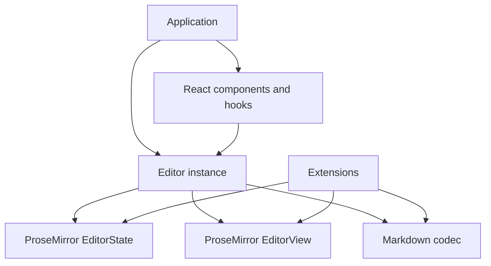

# Architecture

vLab Editor combines ProseMirror editing with a document schema, Markdown rules, an instance lifecycle, and composable React controls. Application storage, authentication, routing, and network transport remain outside the package.

## Layers

`Editor` owns the current snapshot, listeners, callbacks, editing availability, Markdown configuration, and upload tasks. Its state exists before any DOM view is mounted.

`EditorView` owns the editable DOM and browser event handling. `EditorContent` attaches it after React commits and releases it on unmount. This keeps view remounts separate from document/history lifetime and allows a DOM-free server render.

`EditorProvider` exposes the instance. `useEditorState` uses `useSyncExternalStore` to subscribe to a stable snapshot or selected value. `ToolBar` subscribes to the same state and runs native ProseMirror commands against the mounted view. React does not rerender the editable document on every keystroke.

## Document updates

Input and commands create ProseMirror transactions. The editor applies them to state, updates an attached view, and publishes a new snapshot. `onUpdate` observes every applied state change; `onChange` compares documents, and `onSelectionChange` compares selections.

State replacement through `setMarkdown()` validates a complete new document first. Successful replacement resets selection/history and recreates plugin state while preserving the configured schema, keymaps, and NodeViews. Failed conversion has no effect on the live state.

## Conversion

The base schema is in [schema.ts](https://github.com/Victor-Choe/vlab-editor/blob/main/src/engine/schema.ts). [markdown.ts](https://github.com/Victor-Choe/vlab-editor/blob/main/src/engine/markdown.ts) connects `markdown-it` and `prosemirror-markdown`, adds GFM handling, identifies unsupported features, and checks normalized export by parsing it back.

Extensions can add native schema types and Markdown rules together. Schema identity matters: a document from a different schema cannot be passed directly to an editor. Use a schema-aware document factory to restore JSON.

## Uploads and block UI

Pending image positions live in a plugin's mapped decorations. Request controllers live on `Editor`. This separates async transport lifetime from a mounted view and keeps transient upload UI out of document serialization.

Block dragging is an optional extension. It uses document positions and native selections/transactions to move content, while plugin views manage handles and indicators. `BlockSelection` supplies range mapping, bookmarks, and copy/cut behavior for structural selections.

## Source map

| File | Responsibility |
| --- | --- |
| [editor.ts](https://github.com/Victor-Choe/vlab-editor/blob/main/src/engine/editor.ts) | State/view lifecycle, command execution, callbacks, uploads |
| [extensions.ts](https://github.com/Victor-Choe/vlab-editor/blob/main/src/engine/extensions.ts) | Extension contract and schema construction |
| [markdown.ts](https://github.com/Victor-Choe/vlab-editor/blob/main/src/engine/markdown.ts) | Markdown parsing, normalization, export validation |
| [markdown-input.ts](https://github.com/Victor-Choe/vlab-editor/blob/main/src/engine/markdown-input.ts) | Input rules and Markdown paste |
| [media.ts](https://github.com/Victor-Choe/vlab-editor/blob/main/src/engine/media.ts) | Link/image editing commands |
| [image-upload.ts](https://github.com/Victor-Choe/vlab-editor/blob/main/src/engine/image-upload.ts) | Pending upload state and decorations |
| [block-drag.ts](https://github.com/Victor-Choe/vlab-editor/blob/main/src/engine/block-drag.ts) | Handles, drag/drop, structural keyboard interaction |
| [useEditor.ts](https://github.com/Victor-Choe/vlab-editor/blob/main/src/react/useEditor.ts) | React-owned instance and callback synchronization |
| [useEditorState.ts](https://github.com/Victor-Choe/vlab-editor/blob/main/src/react/useEditorState.ts) | Snapshot selection and equality |
| [ToolBar.tsx](https://github.com/Victor-Choe/vlab-editor/blob/main/src/react/ToolBar.tsx) | Shared command context and default toolbar |

Tests run in Node.js and jsdom, covering commands, Markdown conversion, selections, tables, uploads, extensions, React remounts, and server-render/hydration behavior. Browser layout, native drag/drop, clipboard, and IME behavior should also be checked manually when changing those integrations.
